# Deputy

A trust-and-authority layer between an AI assistant and the apps on an Android phone.
The assistant proposes actions; Deputy, which is plain deterministic code, decides what
actually happens, using scoped, revocable, expiring capability tokens. The visible
product is a permission ledger (the Keyring), not a chat box.

This is a personal, build-led exploration of a larger question: how do phone operating
systems evolve once AI agents are first-class actors on them? Deputy probes the userland
half of that question (authority, trust, and the interface between an agent and apps it
does not control), and is designed to extend into the kernel-level half (a forked,
agent-native OS) later.

Status: Phase 0, hobby prototype, single user. Public from the first commit.

## Why

Today's phone assistants are either too weak to be useful or hold the keys to your whole
account. Deputy's bet is that the missing piece is not agent capability but *governed*
capability: narrow, auditable, revocable authority, with the human kept in the loop for
anything irreversible.

## Core principle

Models propose, code disposes. Every action an agent takes flows through the broker,
which is the only component that holds real credentials and the only one that can act.
The broker's enforcement is deterministic code, never an LLM.

## Architecture



- **Broker**: holds credentials, mints and checks capability tokens, enforces flow
  policy, writes the audit log, owns the kill switch. This is the reference monitor and
  the heart of the system. Its state is folded from an append-only, hash-chained journal.
- **Capability tokens**: scoped, budgeted, time-boxed, revocable, and non-delegable by
  default. Each one renders as a single human-readable sentence in the Keyring.
- **Keyring**: the product's main surface. Lists active authority in plain words, offers
  one-tap revoke, and a revoke-all kill switch.
- **Activity**: append-only log of what was done, refused, or asked about, written for a
  person to read. Inbound questions are logged here too: who asked, what, and what was
  answered.
- **Fact store**: the typed record of what Deputy knows about the user, written only by
  the broker. Every fact carries a provenance label and a freshness time. The four
  labels, in descending trust: *attested* (a third party signed it: an mDL, a bank's KYC
  result), *observed* (read from a service through an adapter), *inferred* (a model
  derived it), *asserted* (the user said so). Adapters write into the fact store rather
  than caching privately; it is also the only thing the inbound surface answers from.
- **Dual-model split (CaMeL-style)**: a cloud planner that sees only the user's request
  plus the capability catalog and never touches untrusted content; an on-device model
  that reads untrusted content (email, texts, notifications) into typed slots and holds
  no authority. The broker sits between them.
- **Adapters**: how a capability reaches the world, behind a typed function. Fragility is
  quarantined inside the adapter; the agent only ever sees the typed function. Six tiers,
  best to worst:
  1. *On-device API* (CalendarContract, NotificationListener, MediaStore).
  2. *Cloud API* (Gmail, Google Calendar, a card issuer).
  3. *Code trigger*: Deputy fires the action itself without UI (an intent with extras,
     an App Action, a deep link that completes the action).
  4. *Handed affordance*: Deputy prepares the action and the user's tap finishes it (a
     prefilled deep link, an embedded widget, a share sheet).
  5. *UI driving*: accessibility automation pushing buttons and reading pixels.
  6. *Go to the app*: the user does it themselves. Deputy has offered no utility.

  Tier 4 ranks above tier 5 on purpose: it is sturdier and keeps a human gesture. For
  physical and permanent actions tier 4 is a ceiling set by policy, not by what the app
  happens to expose.
- **Inbound responder**: answers typed questions from other parties. Until public
  reachability is tackled as its own problem, everything is proxied through the phone
  app and any cloud piece is reachable only by Deputy's own app.

## Hard rules

- **No headless actuation of a physical lock.** The garage (Door) adapter embeds the real
  unlock button (via AppWidgetHost) and requires a genuine human tap. Never extract or
  cache a PendingIntent, synthesize a touch, or otherwise fire a physical unlock with no
  human gesture. Physical, irreversible actions keep a human in the loop by design. This
  is the project's own thesis applied to itself.
- **The broker is deterministic code.** Never put an LLM in the enforcement path; that
  rebuilds the vulnerability the project exists to contain.
- **Models never hold raw credentials.** The planner never sees untrusted content or
  secrets.
- **Secrets carry a label and never leak.** One-time codes and the like may never flow
  into an outbound message or up to the cloud planner.
- **Interoperability work stays within the user's own authorized access.** No hunting for
  auth bypasses, and nothing that would function as an exploit for someone without
  legitimate access.
- **Inbound questions are answered by the broker, from the fact store, from a fixed typed
  query vocabulary.** The planner never sees or answers an inbound question; models only
  work on the ingest side. Open-ended natural-language questions about the user are not a
  supported input.

## Action risk tiers

Every capability declares one: reversible (just does it), compensable (undoable with
effort), or permanent (asks first). Permanent and costly actions get an explicit
confirmation; reversible ones run freely. Minimise how often Deputy asks, or people tap
"yes" on reflex and the protection evaporates.

## Build order

- **Phase 0**: broker (token store, policy check, audit log) + Keyring + kill switch +
  one real adapter, end to end. The adapter is the on-device calendar (tier 1): read
  free/busy into the fact store, place and remove holds, send invites (asks first).
  Inbound free/busy was pulled forward in miniature to test the "same broker" claim.
- **Phase 1**: a second on-device adapter (notification triage, with secret labels on
  one-time codes), a cloud-API adapter (Gmail), and the Door garage adapter (tier 4,
  hosted widget), then the dual-model split once there is something to plan over.
- **Phase 2**: the capability-catalog pipeline (scan, label, verify, promote) and
  payment-prefill adapters plus capped-card authority.
- **Phase 3**: the inbound surface. Other parties (services, other people's Deputies)
  ask typed questions about the user; the broker answers deterministically from the fact
  store under inbound grants that appear in the Keyring like any other authority. First
  capability: free/busy.

## Building and running

Kotlin and Gradle (wrapper 9.8.2, AGP 9.4.1, Kotlin 2.4.21), minSdk 29.

```
./gradlew :broker:test         # the reference monitor's tests, on the JVM
./gradlew :app:assembleDebug   # the Android app
adb install -r -g app/build/outputs/apk/debug/app-debug.apk
```

On an emulator, open the Lab tab and tap "Seed test calendar" to create a local calendar
with sample events, then try the suggestions on the Ask tab.

## Repo layout

```
broker/            Pure Kotlin/JVM: the reference monitor. Capabilities, grants, Policy,
                   the journal, the fact store, inbound answering, and all user-facing
                   wording (broker/present). No Android imports.
app/               Android host: Compose UI (Ask, Can do, Keyring, Activity, Lab), the
                   CalendarContract adapter, a scripted planner holding only an AgentPort,
                   and Lab simulations. app/src/debug has an adb-only test driver.
docs/
  design.md        Reasoning: thesis, concept stack, strategy, empirical findings
  decisions.md     Foundational implementation decisions (D1, D2, ...) and assumptions
  log.md           Running build log: what was built, what broke, what it taught
  architecture.svg Current architecture diagram
  agent_os_prototype_system_flow.{svg,png}
                   The original architecture diagram, 2026-10-28
  ux/screens.html  Screen designs, rev 2 (open in a browser)
  Deputy app screens - UX protos.pdf
                   Original screen designs, 2026-10-28
CLAUDE.md          Working rules for Claude Code sessions (imports this README)
```

Empirical scans of the phone's installed apps (the capability scanner, the APK
composition analysis, and their outputs) live outside this repo in `~/code/deputy-scan/`,
because they hold pulled third-party APKs and package dumps. Findings are summarised in
`docs/design.md` section 8.
